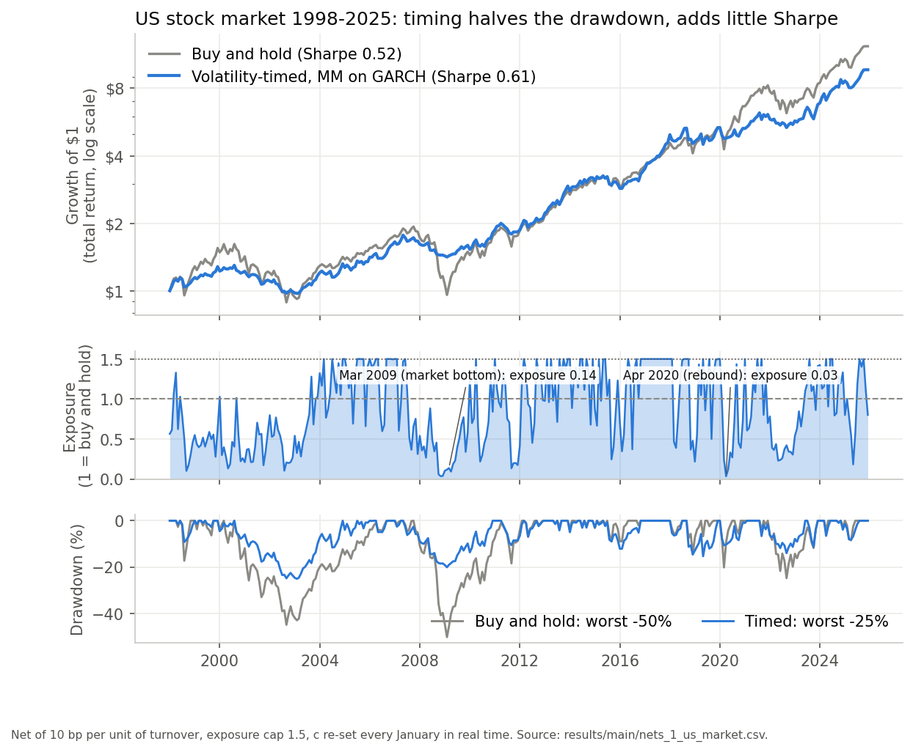
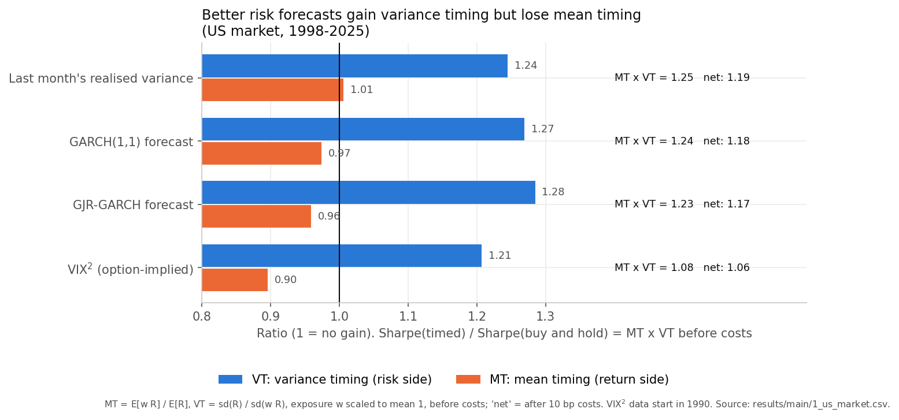
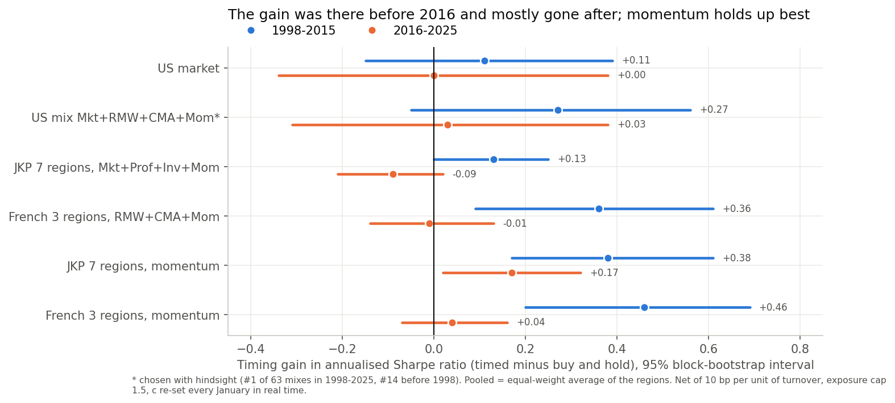
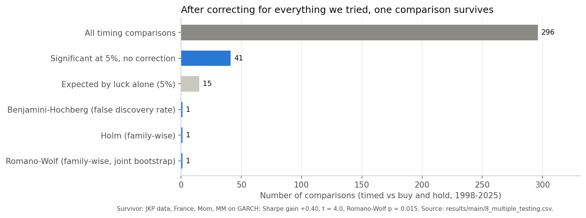
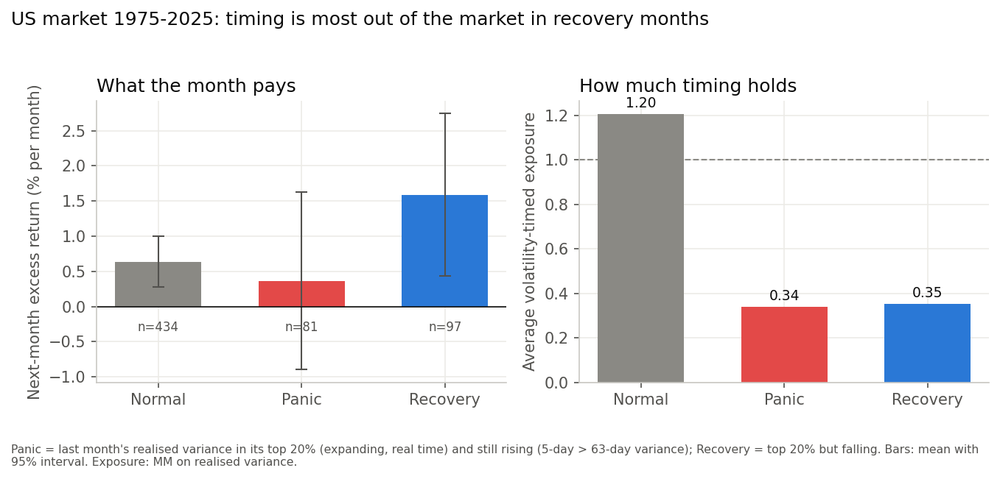

# Decision-Focused Volatility Timing: final version

Hanyang University, Introduction to Financial Engineering, term project (Ayush, Farres, Robin).

**Question.** Volatility timing (Moreira and Muir 2017) scales exposure down when volatility is forecast to be high. Does it
still beat buy-and-hold, and do better volatility forecasts help? Main horizon January 1998 to December 2025, with 1998-2015,
the last 10 years and the last 5 years; US factors and industries, then two independent international data sets.

**Main idea.** Sharpe(timed) / Sharpe(unmanaged) = MT x VT. Better forecasts raise variance timing (VT) but do not fix mean
timing (MT): exposure is cut in high-volatility months that also pay high returns, especially recoveries.

## How to run

```
pip install -r requirements.txt
python run_all.py                 # main spec (SPEC.md); first run fits every GARCH (15-20 min), later runs ~2 min
                                  # order: 1-7, 9, then 8 (multiple testing collects all the others), then make_figures.py
python run_all.py --spec old      # our earlier settings (5 bp, c frozen on pre-1998 data, cap 2)
python run_all.py --spec uncapped # no leverage cap (Moreira-Muir / Robin's setting)
```

Each script can also run alone, e.g. `python 5_us_main_result.py`. Output: `results/<spec>/<script>.txt` (the printed
tables), `.csv` tables and `nets_<script>.csv` (monthly net returns used by script 8).

## What each file does

| File | Plain label | Question it answers |
|---|---|---|
| `SPEC.md` | The frozen protocol | Costs, c rule, cap, periods, bootstrap, tests: fixed before the final run |
| `config.py` | Settings | The numbers in SPEC.md, read by every script |
| `1_us_market.py` | US market, all timing rules | On the stock market alone, which rule works (MM on RV / GARCH / GJR / VIX^2, Xu, conditional, recovery)? |
| `2_us_each_series.py` | US, each factor and industry on its own | Does timing help each of the 6 factors and 10 industries? |
| `3_us_factor_weighting.py` | US, how to weight the six factors | EW vs inverse variance vs min-variance vs tangency, with and without timing |
| `4_us_factor_combos.py` | US, which factor combination is best | All 63 factor combinations ranked, real-time picks, industry groups |
| `5_us_main_result.py` | US, the main result | Factor mixes timed vs unmanaged: Sharpe, Sortino, drawdowns, Cederburg test |
| `6_intl_jkp.py` | International check #1 (JKP data) | Does the US result hold in 8 regions? |
| `7_intl_french.py` | International check #2 (Ken French data) | Same, 6 regions, exact Fama-French definitions, plus leg-wise timing |
| `8_multiple_testing.py` | Multiple testing | Which gains survive Holm / Benjamini-Hochberg / Romano-Wolf across all 296 comparisons? |
| `9_dfl_robin.py` | Decision-focused training (Robin) | Accuracy-trained (QMLE) vs decision-trained (utility) GARCH / GJR / GARCH-LSTM, under our protocol |
| `run_all.py` | Runs 1-7, 9, then 8, then the figures | |
| `make_figures.py` | The five README / slide figures | Reads `results/main/`, writes `figures/` |
| `docs/` | Progress-report slides (6 October 2026) | |
| `CHRONOLOGY.md` | How we got here | Every step: question, reasoning, files, results; which numbers are final and which exploratory |
| `robin_experiment/` | Robin's Experiment 1 | His code, tables and report; `NOTE.md` says what was copied |
| `core/garch.py` | Volatility forecast | Real-time GARCH(1,1) / GJR, refit every January, exact FFT filter |
| `core/rule.py` | Trading rule | Exposure c / v, the c rule, the cap, costs |
| `core/variants.py` | Rule variants | Xu switches, conditional quintiles, recovery state |
| `core/stats.py` | Statistics | Sharpe, Sortino, drawdown, block bootstrap, Cederburg combination, Holm / BH / Romano-Wolf |
| `core/data.py`, `core/report.py` | Loading and output | |
| `data/` | Inputs | Ken French US factors and industries (daily, monthly), RF, VIX, JKP factors (`jkp/`), French regional factors (`ff_intl/`), Robin's saved forecasts (`robin/`) |

## Results under the main spec (net of 10 bp, cap 1.5; re-run before citing)

| Test, 1998-2025 | Timing gain in Sharpe [95% CI] | After 2016 |
|---|---|---|
| US market, MM on GARCH | +0.09 [-0.13, +0.33]; max drawdown -25% vs -50% | +0.00 |
| US, 16 series, MM on GARCH (mean) | +0.00, 7 of 16 gain | |
| US mix Mkt + RMW + CMA + Mom (chosen with hindsight) | +0.19 [-0.05, +0.42]; Sharpe 1.04 vs 0.85, Sortino 1.82 vs 1.33 | +0.03 |
| JKP, 7 regions pooled, Mkt + Prof + Inv + Mom | +0.05 [-0.05, +0.16] (+0.13 in 1998-2015, 7/7 regions) | -0.09, 0/7 |
| JKP, 7 regions pooled, momentum alone | +0.30 [+0.14, +0.48], 7/7 | +0.17 [+0.02, +0.32], 7/7 |
| French, 3 regions pooled, RMW + CMA + Mom | +0.27 [+0.04, +0.49], 3/3 | -0.01 |
| French, 3 regions pooled, momentum alone | +0.34 [+0.12, +0.53], 3/3 | +0.04 |
| Decision-trained GARCH-LSTM vs accuracy-trained (Robin, 6 factors) | +0.10 to +0.12 on HML, RMW, CMA, ~0 elsewhere; none significant; forecasts 1.2-3.5x worse (QLIKE) | |
| Multiple testing (296 comparisons) | 41 nominally significant (15 expected by luck); 1 survives Romano-Wolf (momentum, France) | |

Reading:
1. Timing almost always cuts drawdowns, but it adds little Sharpe: about +0.1 on the US market, zero across the panel.
2. Where it helps, it helped before 2016 and stopped after, in the US and abroad. Momentum is the exception that keeps working.
3. The Cederburg real-time test (combining timed and unmanaged with weights estimated on the past) passes almost nowhere.
4. After correcting for everything we tried, only vol-managed momentum (Barroso and Santa-Clara 2015) is close to robust.

## Key figures

All five come from `make_figures.py`, which reads the tables in `results/main/` (it runs at the end of `run_all.py`).

### 1. The US market: smaller drawdowns, little extra Sharpe



MM on GARCH vs buy and hold, 1998-2025, after costs. The timed strategy halves the worst drawdown (-25% vs -50%), and Sharpe
rises from 0.52 to 0.61 (gain +0.09, 95% CI [-0.13, +0.33]). Its final wealth is lower because it averages 0.88 exposure. The
middle panel shows the problem: exposure was 0.14 at the March 2009 bottom and 0.03 in April 2020, right before the two
biggest rebounds.

### 2. Why better forecasts don't help: MT x VT



Sharpe(timed) / Sharpe(buy and hold) = MT x VT. VT (variance timing) is above 1 for every forecast, so the risk side works.
MT (mean timing) falls as the forecast gets "better": 1.01 for last month's realised variance, 0.97 for GARCH, 0.96 for GJR
and 0.90 for VIX². Better forecasts cut exposure more sharply in high-volatility months, and those months also pay high
returns. That is the core result of the project.

### 3. The gain disappears after 2016



The same rule on US data, the JKP data (7 regions pooled) and the Ken French regional data (3 regions pooled). Every gain is
positive in 1998-2015 and close to zero or negative in 2016-2025. Momentum is the exception that holds up best. The US mix
(starred) was chosen with hindsight.

### 4. Multiple testing: 1 of 296 survives



We ran 296 timing comparisons. 41 are significant without correction, against about 15 expected by luck. After the
Benjamini-Hochberg, Holm or Romano-Wolf corrections, one survives: vol-managed momentum in France (JKP data).

### 5. The mechanism: timing is out of the market when it pays most



Months are split by last month's volatility, measured in real time. "Panic" is high and rising; "recovery" is high and
falling. Recovery months pay the most (about 1.6% a month in 1975-2025), yet the timed strategy holds only about 0.35 exposure
in them. A volatility forecast can't tell a panic from a recovery, which is why MT drops. The intervals are wide (97 recovery
months), so this is a mechanism, not a tradable signal on its own.

Robustness: `old` and `uncapped` give the same picture (with the old settings the US mix gain is a bit larger, +0.24
[-0.00, +0.48], and 3 comparisons survive Romano-Wolf, all momentum or momentum mixes in Europe). One result depends on the spec: leg-wise timing in script 7 (market
leg unmanaged, other legs timed) beats timing the whole mix with the 1.5 cap, but not with the old cap of 2. It was designed
after seeing script 6, so it is reported as post-hoc.

## Repository layout (GitHub branches)

| Branch | What it holds |
|---|---|
| `main` | This final version: frozen protocol, scripts 1-9, results for all three specs, figures, `docs/` (progress-report slides) |
| `exploratory` | The working folder from before the protocol was frozen (CHRONOLOGY Steps 0-8, earlier settings). Every `fe_project/...` path in CHRONOLOGY.md is there |
| `old` | The previous main (first data pipeline and README), with its history |
| `team/robin` | Robin's Experiment 1 exactly as delivered |

## Data sources

- Kenneth R. French Data Library: US factors, 10 industries, regional factors (downloaded October 2026).
- JKP Global Factor Data (Jensen, Kelly and Pedersen 2023), jkpfactors.com, capped value weights (downloaded 6 October 2026).
- FRED: VIXCLS.

## Not in this folder

Exploratory work that is not part of the final results (the first decision-focused diagnosis, VRP, intermediary capital ratio,
Kalman filters, GARCH-X, the GINN network, VIX term structure) lives in the project's working folders and used our earlier
settings; every one of those signals was insignificant. `CHRONOLOGY.md` lists those files step by step.
